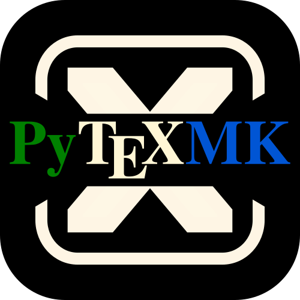
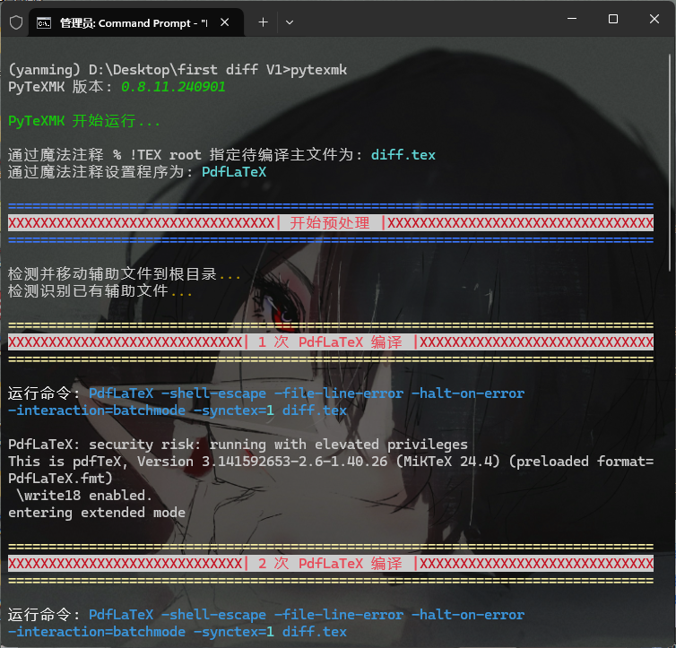
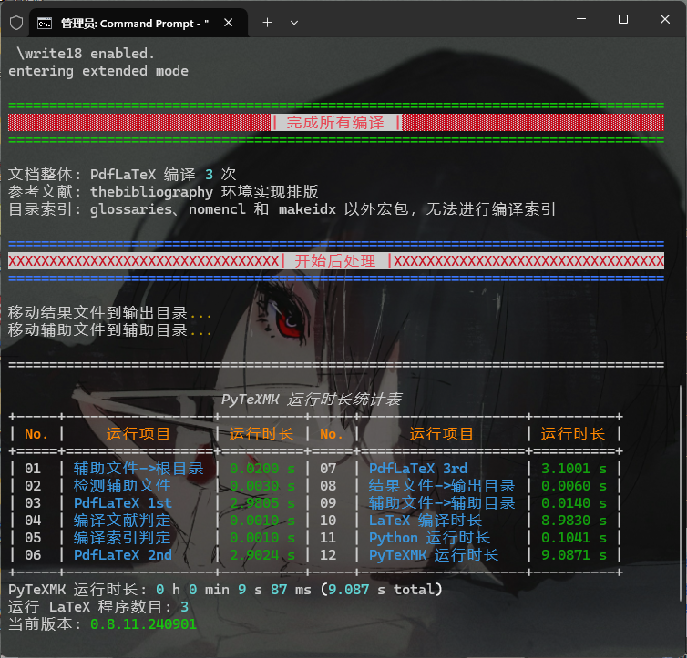

<div align="center">
  
  <h1>PyTeXMK</h1>
  <p>LaTeX Auxiliary Compilation Command Line Tool</p>

  <p>
    <a href="https://pypi.python.org/pypi/pytexmk/">
      
    </a>
    <a href="https://pypi.org/project/pytexmk/">
      
    </a>
    <a href="https://github.com/YanMing-lxb/PyTeXMK/releases/latest">
      
    </a>
    <a href="https://github.com/YanMing-lxb/PyTeXMK/blob/main/LICENSE">
      
    </a>
    <a href="#">
      
    </a>
  </p>

  <p>
    <a href="https://github.com/YanMing-lxb/PyTeXMK/issues">
      
    </a>
    <a href="https://github.com/YanMing-lxb/PyTeXMK">
      
    </a>
    <a href="https://github.com/YanMing-lxb/PyTeXMK">
      
    </a>
    <a href="https://star-history.com/#YanMing-lxb/PyTeXMK&Date">
      
    </a>
  </p>

  <p>
    <a href="README.md">简体中文</a>
    ·
    <a href="README.en.md">English</a>
  </p>
</div>

---

**PyTeXMK** (Python TeX Make) is an automated LaTeX build tool written in Python, inspired by `latexmk`. It intelligently determines the number of compilation passes based on auxiliary file changes, with Rich-colored terminal output and automatic bibliography/index toolchain orchestration — making the LaTeX build workflow a one-shot command.

> 🆕 **1.2.18**: preflight blockers now exit non-zero; `-r` is now an on-demand report entry (reads the latest log and writes JSON + text); a batch of long options (`--json`, `--doctor`, `--completion`, …) were removed and build/submission switches moved to config; `-ls` writes the subproject list; `-i/-iu` overwrite by default.

---

## ✨ Features

### Core Compilation

- 🚀 **Multi-engine support**: XeLaTeX, PdfLaTeX, LuaLaTeX — switch freely via CLI flags or magic comments
- 🔁 **Smart multi-pass detection**: Automatically diffs `.aux`/`.out` file contents and parses Rerun warnings in logs, ensuring cross-references, hyperref bookmarks, and page counts converge stably
- 📋 **Structured compile-detection report**: After each pass, outputs a 6-dimension status report (bibliography, index, TOC, cross-references, bookmark file, log rerun), clearly showing which dimensions are stable and what's expected next
- 🐍 **PythonTeX orchestration**: After the first pass creates `.pytxcode`, run `pythontex` automatically and add one LaTeX pass; native builds run inside the auxiliary directory

### Bibliography & Index

- 📚 **Bibliography**: Auto-orchestrate bibtex / biblatex (biber) / thebibliography
- 📑 **Index & glossary**: glossaries (incl. glossaries-extra + bib2gls + biber), nomencl, makeidx — auto-selects xindy or makeindex backend
- 🔮 **Magic comments**: Customize compilation behavior via `% !TEX` comments (engine, main file, output dir, auxiliary dir)

### Helper Tools

- 🧹 **Smart cleanup**: Multiple clean modes for precise auxiliary file removal by directory scope or file suffix
- 🔍 **Log parsing**: Auto-parse LaTeX logs on failure to locate error positions
- 🖼 **PDF repair & preview**: Auto-repair corrupted PDFs; open default viewer after compilation

> Diff comparison is no longer built in: since 1.2.18, run `latexdiff old.tex new.tex > LaTeXDiff.tex` yourself, then `pytexmk LaTeXDiff`.

### Configuration & Extensibility

- 🌍 **Internationalization**: Multi-language UI support (default: Chinese)
- ⚙️ **Two-level config**: User-level and project-level `.pytexmkrc`, every parameter is customizable
- 🧩 **Multi-subproject management**: Manage and compile multiple independent subprojects under one root directory
- 🧪 **CI & diagnostics**: compile failures exit `5`; `-r` exports the latest log to JSON + text for archiving and issue reports

---

## 📸 Preview

<div align="center">
  
  
</div>

---

## 🚀 Quick Start

### Prerequisites

Before installing PyTeXMK, make sure your system has the following:

1. **Python 3.15+** (managing with uv recommended)
2. **A LaTeX distribution** (pick one):
   - **Windows**: [MiKTeX](https://miktex.org/) or [TeX Live](https://tug.org/texlive/)
   - **macOS**: [MacTeX](https://www.tug.org/mactex/) or BasicTeX
   - **Linux**: TeX Live (distro package or official install)
3. **Optional tools** (install as needed):
   - `biber` (biblatex backend for bibliography processing)
   - `xindy` (glossaries backend for glossary compilation)
   - `latexdiff` (only needed when you generate diff files manually)

### Installation

#### Via pip or uv

```bash
# Install with pip
pip install pytexmk

# Install the CLI with uv (recommended)
uv tool install pytexmk
```

#### Windows winget (recommended, no Python required)

```powershell
winget install --id YanMing-lxb.PyTeXMK
```

#### Linux / macOS binary package (recommended, no Python required)

Pick the matching asset from [Releases](https://github.com/YanMing-lxb/PyTeXMK/releases):

- Linux x86_64: `pytexmk-<version>-linux-x64.zip`
- macOS Apple Silicon: `pytexmk-<version>-macos-arm64.zip`

Or install it with a single command (the installer detects platform and architecture, resolves the latest version, checks glibc and creates the launcher; re-running it upgrades in place):

```bash
curl -fsSL https://raw.githubusercontent.com/YanMing-lxb/PyTeXMK/main/tools/install.sh | bash -s
```

It installs into `~/.local/opt/pytexmk` and links the launcher to `~/.local/bin/pytexmk`. To customise, append `--` followed by the flags:

```bash
# Custom program directory and launcher directory
curl -fsSL https://raw.githubusercontent.com/YanMing-lxb/PyTeXMK/main/tools/install.sh | bash -s -- -d ~/opt/pytexmk -b ~/.local/bin

# Pin a specific version
curl -fsSL https://raw.githubusercontent.com/YanMing-lxb/PyTeXMK/main/tools/install.sh | bash -s -- -v 1.2.18

# Use the uv channel instead (installs from PyPI, needs uv; for Intel Macs or old glibc)
curl -fsSL https://raw.githubusercontent.com/YanMing-lxb/PyTeXMK/main/tools/install.sh | bash -s -- -m uv

# Show all options
curl -fsSL https://raw.githubusercontent.com/YanMing-lxb/PyTeXMK/main/tools/install.sh | bash -s -- -h
```

> **Notes**
> - The installer only needs `curl` and `unzip` (e.g. `sudo apt install curl unzip`); a LaTeX distribution (TeX Live / MiKTeX / MacTeX) is still required as described in Prerequisites.
> - Output language follows the system locale (Chinese locales get Chinese, everything else gets English); force it with `-l zh` or `-l en`.
> - **Only two binary architectures are published**: `x64` for Linux and `arm64` for macOS. On Intel Macs use the uv channel (`uv tool install pytexmk`, or pass `-m uv` to the script); the installer refuses a package that does not match your architecture.
> - **glibc ≥ 2.28 is required on Linux** (Ubuntu 20.04+, Debian 10+, RHEL 8+, etc.). The binary is built inside a `manylinux_2_28` container and CI asserts that nothing in the bundle (including the bundled `.so` files under `_internal`) exceeds that floor. The script checks this before downloading and points you to `uv tool install pytexmk` when your glibc is too old; pass `-f` to force the install anyway.
> - The install lives in your home directory (`~/.local/opt/pytexmk`) and needs no `sudo`; if `~/.local/bin` is not on your `PATH`, the script prints the exact `export` line to add.
> - The archive is a PyInstaller onedir tree: the `pytexmk` launcher and `_internal/` (which holds `_internal/data` and the `_internal/locale` message catalogs) must stay in the same directory. The script replaces the whole directory; when installing manually, **do not copy the `pytexmk` file on its own**.

### Upgrade

```bash
# pip
pip install --upgrade pytexmk

# uv (upgrade to latest)
uv tool upgrade pytexmk

# winget
winget upgrade --id YanMing-lxb.PyTeXMK
```

For the Linux / macOS binary package, just re-run the install command (the script detects an existing install and replaces it in place; this is also the command printed by `pytexmk --help`):

```bash
curl -fsSL https://raw.githubusercontent.com/YanMing-lxb/PyTeXMK/main/tools/install.sh | bash -s
```

### Uninstall

```bash
# Linux binary package: remove the program directory and the launcher symlink
# (swap in your own paths if you installed with -d / -b)
rm -rf ~/.local/opt/pytexmk ~/.local/bin/pytexmk

# pip install
pip uninstall pytexmk

# uv install
uv tool uninstall pytexmk
```

### Basic Usage

Run in your LaTeX project root:

```bash
# Compile with defaults (XeLaTeX + main.tex + Build/)
pytexmk

# Compile a specific main file
pytexmk main.tex

# Compile with PdfLaTeX
pytexmk -p main.tex

# Compile + preview PDF
pytexmk main.tex -pv

# Read the latest log only and write JSON + Markdown reports (does not compile)
pytexmk main.tex -r

# Clean auxiliary files (-c: aux dir; -C: plus root and outputs)
pytexmk -c
```

> **Note**: PyTeXMK only supports UTF-8 encoded TeX files.

---

## ⚙️ Default Configuration

| Option | Default | Description |
| --- | --- | --- |
| Compiler | `XeLaTeX` | Options: XeLaTeX, PdfLaTeX, LuaLaTeX |
| Main file | `main.tex` | LaTeX main file to compile |
| Output dir | `Build` | Compilation result directory |
| Auxiliary dir | `Auxiliary` | Auxiliary files directory |
| Compile mode | batch mode | Silent compilation, no verbose log output in terminal |

> **Tip**: All parameters can be customized in config files. See [Configuration File](#configuration-file).
>
> **VSCode users**: Set `"latex-workshop.latex.outDir": "./Build"` in `settings.json` so LaTeX-Workshop can find the PDF.

---

## 📖 Usage

### Compilation Engine & Modes

| Option | Description |
| --- | --- |
| `-p`, `--pdflatex` | Compile with PdfLaTeX |
| `-x`, `--xelatex` | Compile with XeLaTeX (default) |
| `-l`, `--lualatex` | Compile with LuaLaTeX |
| `-d`, `--draft` | Draft mode: compile without including images (faster) |
| `-f`, `--force-rebuild` | Ignore the build cache and recompile |
| `-nq`, `--non-quiet` | Non-quiet mode: stream the compilation log to the terminal (overrides `quiet_mode = true`; does **not** change `-interaction`) |
| `-vb`, `--verbose` | Verbose mode: INFO-level workflow logs (same as 1.2.7, never DEBUG; quiet mode does not change the log level) |
| `-pa ARG`, `--pass-arg ARG` | Pass an extra argument to the TeX engine (repeatable, e.g. `-pa=-8bit`) |
| `-w`, `--watch` | Watch sources and recompile automatically (1s poll, 400ms debounce, Ctrl+C to stop) |
| `-ap`, `--all-subprojects` | Compile every `[subprojects]` entry in order, continue on failure, summarize and exit non-zero |
| `-r`, `--report` | Read the latest log and write `Auxiliary/<main>.pytexmk-report.json` plus a matching `.md`; does not compile |
| `-e`, `--explain` | Print the effective build plan (including the absolute PDF path) and exit without compiling |
| `-sc`, `--show-config` | Print the merged configuration (default < user < project) |

> TeX's `-interaction` is controlled only by `[build] interaction`; the CLI no longer offers this switch.
>
> Short options are single-character by default; two-character names remain only where the semantics need them (`-nq`/`-ca`/`-Ca`/`-pa`/`-sp`/`-vb`/`-pv`/`-iu`/`-ls`/`-sc`/`-ap`/`-rp`). Short options cannot be clustered (`-dc` and the like exit `2`).
>
> `-p`/`-x`/`-l` select one compiler engine; giving more than one exits `2` with an argument error.

Build switches live in the config file; the CLI no longer duplicates them:

| Key | Default | Description |
| --- | --- | --- |
| `[build] native` | `"auto"` | Native named-directory build (aux files go straight into `Auxiliary/`) |
| `[build] shell_escape` | `"true"` | Allow `\write18` (on by default; `"auto"` detects minted/pythontex/etc.) |
| `[build] synctex` | `true` | Generate `.synctex.gz`; disabling breaks editor jumps |
| `[build] max_extra_compilations` | `8` | Extra compilation passes after the first run |
| `[preflight] enabled` | `true` | Pre-compile checks (missing `\end{document}`, `.bib`, graphics, etc.) |

### CI & diagnostic reports

```bash
# Normal build; the terminal shows warning/error summaries, exit 5 means compile failure
pytexmk -x main

# Read the latest log only and write JSON + Markdown reports (does not compile)
pytexmk main -r
```

`-r` takes no argument and uses fixed paths:
`Auxiliary/<main>.pytexmk-report.json` and
`Auxiliary/<main>.pytexmk-report.md`. A missing readable log exits with `1`;
if the Markdown export fails, the JSON is kept and the process exits with `9`.

`ERROR` / `WARNING` messages wrap at 100 columns at most (or the terminal width
when narrower); continuation lines are indented 9 spaces to align with the
message column, with no trailing padding.

For CI, use exit codes directly: `0` on success, `5` on compile failure. When you
need an archived diagnostic, append `pytexmk -r` after the build command.

### Submission & pdflatex Compatibility

| Option | Description |
| --- | --- |
| `-sp`, `--submission-pack` | Build `Submission/<project>-submission.zip`: `.fls` dependencies + **all `.bib`** + unmodified source copies + notes (no `.bbl`); a sibling `<project>-submission.log` holds the diagnostics (never packed). On its own it **packs only, no build** (reuses the existing `Build`/`Auxiliary`); use `-f -sp` to compile and pack, and any clean flag combined with `-sp` still compiles first |

Submission directory and preamble handling moved to `[submission]`:

| Key | Default | Description |
| --- | --- | --- |
| `[submission] output_dir` | `"./Submission/"` | Submission output directory |
| `[submission] keep_preamble` | `false` | `true` keeps the original preamble (default comments out fontspec/unicode-math/ctex) |

> If the journal only accepts pdflatex, `-sp` comments out
> fontspec/unicode-math/ctex and adds `fontenc`/`inputenc`/`textcomp`, but it
> does **not** convert Unicode characters in the body: the submission copy stays
> byte-faithful, and Greek letters, `°`, CJK and the like are merely reported for
> you to fix by hand. Up to five issues are listed below the last rule of the
> summary panel; anything beyond that points to the diagnostic log, and packages
> the sanitizer already commented out appear in the panel as “no manual edit
> needed” instead of taking those five slots; findings
> never abort the run (exit code stays 0). The pack carries only every `.bib`,
> never the compiled `.bbl`; references are rebuilt on the journal side after
> running bibtex/biber. Per-character counts, `file:line` details and package
> reasons go to the sibling `<project>-submission.log`. Compatibility scanning
> only covers files actually packed: drafts that no `.fls` entry references and
> that never enter the zip (e.g. another language variant) are ignored.

### Cleanup

| Option | Description |
| --- | --- |
| `-c`, `--clean` | Clean the current main file's auxiliary files (auxiliary dir only) |
| `-C`, `--clean-out` | Clean auxiliary files (auxiliary dir + root) and remove PDF/SyncTeX from the output dir |
| `-ca`, `--clean-recursive` | Recursively clean auxiliary files across the project (no unique main file required) |
| `-Ca`, `--clean-recursive-out` | Recursively clean auxiliary files; also removes main-file outputs when the main file is known |

- `-c/-C` need a unique main file; multiple candidates without `default_file` exit `1`.
- `-ca/-Ca` match by suffix, skip `tests/`, `examples/`, `dist/`, `docs/`, `.venv`;
  `.bbl`, `.xdv` and `.xdy` are treated as artifacts, with no “possibly author-owned” list.
- The four clean modes are mutually exclusive (like the `-p/-x/-l` engine choice); passing more than one clean flag exits with argument error `2` and no scope merge is performed. Cleaning finishes and the run exits; no follow-up build is performed.

### PDF Tools

| Option | Description |
| --- | --- |
| `-rp`, `--pdf-repair` | Repair corrupted PDF files (e.g. `invalid X X R object` warnings caused by bad images) |
| `-pv`, `--pdf-preview` | Open browser or local PDF viewer after compilation |

### Multi-Subproject Management

PyTeXMK lets you manage multiple independent subprojects under a single project root, each with its own compilation config and output directory.

**Typical workflow**:

```bash
# 1. Generate root config file
pytexmk -i

# 2. Scan, show and write back the subproject list (preserves aliases, comments and order)
pytexmk -ls

# 3. Compile a specific subproject (can be combined with a main file)
pytexmk -s thesis main.tex
```

| Option | Description |
| --- | --- |
| `-s`, `--subproject <name>` | Select a subproject and compile/clean in its directory |
| `-ls`, `--list-subprojects` | Scan and write the `[subprojects]` section; when the root config is missing it is created from the built-in template first |

### Config File Generation

| Option | Description |
| --- | --- |
| `-i`, `--init` | Generate a project-level `.pytexmkrc`; an existing file is overwritten |
| `-iu`, `--init-user` | Generate a user-level `.pytexmkrc`; an existing file is overwritten |

> Normal builds and `-r` never create user/project config files; `-ls` creates the project config when the root file is missing.

### Others

| Option | Description |
| --- | --- |
| `document` | Positional argument: filename to compile (extension optional) |
| `-h`, `--help` | Show help message |
| `-v`, `--version` | Show program version |

### Magic Comments

PyTeXMK supports magic comments in the first 50 lines of your LaTeX main file to customize compilation behavior:

| Magic Comment | Description | Example |
| --- | --- | --- |
| `% !TEX program = <engine>` | Set compilation engine | `% !TEX program = PdfLaTeX` |
| `% !TEX root = <filename>` | Set main file to compile | `% !TEX root = main` |
| `% !TEX outdir = <dir>` | Set output directory | `% !TEX outdir = output` |
| `% !TEX auxdir = <dir>` | Set auxiliary directory | `% !TEX auxdir = auxfiles` |

> **Note**: Magic comments only work in the main file; comments in sub-files are ignored.

### How It Works

<details>
<summary><b>📂 Main File Auto-Detection</b></summary>

1. CLI argument explicitly specifies a file → use it
2. Only one `.tex` file in current directory → auto-select
3. `% !TEX root` magic comment exists → use the comment value
4. Search for `\documentclass` or `\begin{document}` (first 200 lines) → identify main file
5. Fallback to default `main.tex`

</details>

<details>
<summary><b>⚙️ Engine Selection</b></summary>

1. CLI flag `-p` / `-x` / `-l` → highest priority
2. Magic comment `% !TEX program` → use the comment value
3. None specified → default `XeLaTeX`

</details>

<details>
<summary><b>🔁 Automatic Compile Passes</b></summary>

1. First LaTeX compilation pass
2. If `.aux` contains bibliography references, invoke bibtex / biber
3. If glossaries/index are present, invoke makeindex / xindy
4. Continue LaTeX passes; after each pass, detect whether each dimension has converged
5. Stop when all dimensions are stable or the safety cap is reached

</details>

### Configuration File

PyTeXMK supports two levels of TOML-format configuration:

| Level | Windows | Linux / macOS |
| --- | --- | --- |
| User-level | `C:\Users\username\.pytexmkrc` | `~/.pytexmkrc` |
| Project-level | `./.pytexmkrc` | `./.pytexmkrc` |

**Priority**: Project-level > User-level > Built-in defaults

Generate a template with `pytexmk -i` (project-level) or `pytexmk -iu` (user-level). Generated templates include detailed inline comments.

---

## 🛠 Development & Build

### Requirements

- Python 3.15+
- [uv](https://github.com/astral-sh/uv) (recommended) or pip

### Development Setup

```bash
# Clone the repository
git clone https://github.com/YanMing-lxb/PyTeXMK.git
cd PyTeXMK

# Install development dependencies
uv sync --all-extras --dev

# Run development version
uv run pytexmk --help
```

### Build Distribution

```bash
# Build wheel and sdist
uv build
```

### Build Binary

```bash
# Generate platform icons
make icon

# Build source-mode executable (onedir layout)
make build

# Clean build artifacts
make clean
```

> **make on Windows** requires separate setup. See [Using make on Windows](docs/Window%20下使用%20make.md).

### Code Linting

```bash
uv run ruff check src/
uv run ruff format src/
```

### Internationalization Workflow

```bash
# Add a new language
make add-lang

# Update all pot/po files
make update

# Compile po → mo
make mo

# Re-extract all pot templates
make pot
```

> The workflow is Babel-based (`pybabel extract/init/update/compile`, wrapped in `tools/i18n/babel.py`); `.mo` files are loaded at runtime by the stdlib gettext loader.

---

## 📄 License

This project is open-sourced under the [GPLv3](LICENSE) license.

---

## 📝 Changelog

For detailed changelog, please refer to [CHANGELOG.md](CHANGELOG.md).

---

## 🤝 Contributing

Issues and Pull Requests are welcome!

- 🐛 Found a bug? Please file an [Issue](https://github.com/YanMing-lxb/PyTeXMK/issues)
- 💡 Have a feature request? Start a discussion
- 🌍 Want to help translate? See the [i18n workflow](#internationalization-workflow) above

---

## ⭐ Star History

[](https://star-history.com/#YanMing-lxb/PyTeXMK&Date)

---

<div align="center">

**If you find this project helpful, please give it a Star ⭐ to show your support!**

</div>
