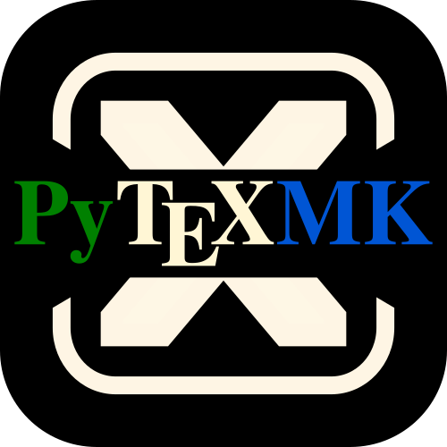
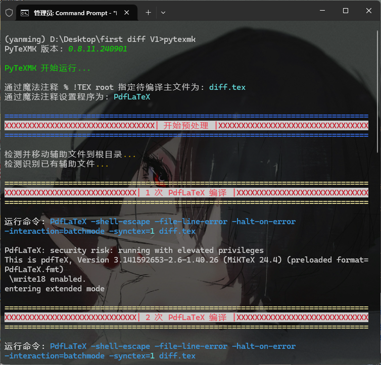
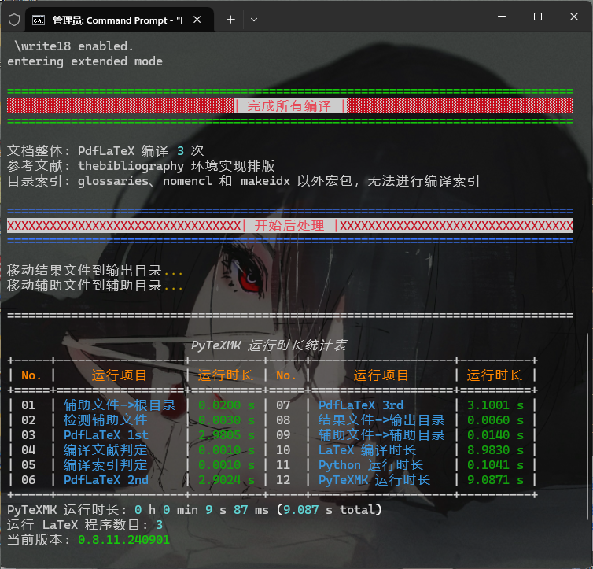

<div align="center">
  
  <h1>PyTeXMK</h1>
  <p>LaTeX 辅助编译命令行工具</p>

  <p>
    <a href="https://pypi.python.org/pypi/pytexmk/">
      
    </a>
    <a href="https://pypi.org/project/pytexmk/">
      
    </a>
    <a href="https://github.com/YanMing-lxb/PyTeXMK/releases/latest">
      
    </a>
    <a href="https://github.com/YanMing-lxb/PyTeXMK/blob/main/LICENSE">
      
    </a>
    <a href="#">
      
    </a>
  </p>

  <p>
    <a href="https://github.com/YanMing-lxb/PyTeXMK/issues">
      
    </a>
    <a href="https://github.com/YanMing-lxb/PyTeXMK">
      
    </a>
    <a href="https://github.com/YanMing-lxb/PyTeXMK">
      
    </a>
    <a href="https://star-history.com/#YanMing-lxb/PyTeXMK&Date">
      
    </a>
  </p>

  <p>
    <a href="README.md">简体中文</a>
    ·
    <a href="README.en.md">English</a>
  </p>
</div>

---

**PyTeXMK**（Python TeX Make）是一个用 Python 编写的 LaTeX 自动化编译工具，灵感来源于 `latexmk`。它能够根据辅助文件变化智能决定编译轮次，配合 Rich 彩色输出、参考文献/索引工具链自动调度，让 LaTeX 编译工作流一键完成。

> 🆕 **1.2.18**：预检阻断现在以非零退出码结束；`-r` 改为按需报告入口（只读最近一次日志，生成 JSON + Markdown）；删除 `--json`/`--doctor`/`--completion` 等一批长选项，构建/投稿开关移到配置文件；`-ls` 直接写回子项目清单；`-i/-iu` 默认覆盖已有配置。

---

## ✨ 功能特性

### 核心编译

- 🚀 **多引擎支持**：XeLaTeX、PdfLaTeX、LuaLaTeX，通过命令行参数或魔法注释灵活切换
- 🔁 **智能多次编译检测**：自动比较 `.aux`/`.out` 文件内容并解析日志 Rerun 警告，确保交叉引用、hyperref 书签、总页数等收敛稳定
- 📋 **结构化编译检测报告**：每轮编译结束后输出 6 维检测状态（参考文献、索引、目录、交叉引用、书签文件、日志重编译），清晰展示各维度是否稳定及预期下一步
- 🐍 **PythonTeX 自动调度**：首轮生成 `.pytxcode` 后自动运行 `pythontex` 并补一轮 LaTeX，native 构建在辅助目录内执行

### 参考文献与索引

- 📚 **参考文献**：自动调度 bibtex / biblatex（biber）/ thebibliography
- 📑 **索引与术语表**：glossaries（含 glossaries-extra + bib2gls + biber）、nomencl、makeidx，自动选择 xindy 或 makeindex 后端
- 🔮 **魔法注释**：通过 `% !TEX` 注释指定编译引擎、主文件、输出目录、辅助目录等

### 辅助工具

- 🧹 **智能清理**：多种清理模式，支持按目录范围和文件后缀精确清理辅助文件
- 🔍 **日志解析**：编译失败后自动解析 LaTeX 日志，定位错误位置
- 📝 **LaTeXDiff**：两个 LaTeX 文件差异对比，生成带修订标记的 PDF
- 🖼 **PDF 修复与预览**：损坏 PDF 自动修复，编译后自动预览

### 配置与扩展

- 🌍 **国际化**：支持多语言界面，默认中文
- ⚙️ **两级配置文件**：用户级 + 项目级 `.pytexmkrc`，所有参数均可自定义
- 🧩 **多子项目管理**：一个根目录下管理多个独立子项目，支持自动扫描和逐一编译
- 🧪 **CI 与诊断**：编译失败以退出码 `5` 结束；`-r` 把最近一次日志导出为 JSON + Markdown 报告，便于归档与贴到 issue

---

## 📸 预览

<div align="center">
  
  
</div>

---

## 🚀 快速开始

### 前置条件

在安装 PyTeXMK 之前，请确保你的系统已安装以下组件：

1. **Python 3.15+**（通过 uv 管理推荐）
2. **LaTeX 发行版**（任选其一）：
   - **Windows**: [MiKTeX](https://miktex.org/) 或 [TeX Live](https://tug.org/texlive/)
   - **macOS**: [MacTeX](https://www.tug.org/mactex/) 或 BasicTeX
   - **Linux**: TeX Live（发行版自带或官方安装）
3. **可选工具**（按需安装）：
   - `biber`（biblatex 后端，用于参考文献处理）
   - `xindy`（glossaries 后端，用于术语表编译）
   - `latexdiff`（LaTeX 文件差异对比）

### 安装

#### 通过 pip 或 uv

```bash
# 使用 pip 安装
pip install pytexmk

# 使用 uv 安装 CLI（推荐）
uv tool install pytexmk
```

#### Windows winget（推荐，无需 Python 环境）

```powershell
winget install --id YanMing-lxb.PyTeXMK
```

#### Linux / macOS 二进制包（推荐，无需 Python 环境）

从 [Releases](https://github.com/YanMing-lxb/PyTeXMK/releases) 下载对应资产：

- Linux x86_64：`pytexmk-<版本>-linux-x64.zip`
- macOS Apple Silicon：`pytexmk-<版本>-macos-arm64.zip`

或用一条命令安装（安装脚本会自动识别平台与架构、取最新版本、校验 glibc、创建启动器；重复执行即为就地升级）：

```bash
curl -fsSL https://raw.githubusercontent.com/YanMing-lxb/PyTeXMK/main/tools/install.sh | bash -s
```

默认安装到 `~/.local/opt/pytexmk`，启动器软链到 `~/.local/bin/pytexmk`。需要自定义时在末尾追加 `--` 再带参数：

```bash
# 指定程序目录与软链目录
curl -fsSL https://raw.githubusercontent.com/YanMing-lxb/PyTeXMK/main/tools/install.sh | bash -s -- -d ~/opt/pytexmk -b ~/.local/bin

# 固定版本
curl -fsSL https://raw.githubusercontent.com/YanMing-lxb/PyTeXMK/main/tools/install.sh | bash -s -- -v 1.2.18

# 改用 uv 渠道（从 PyPI 源码安装，需已装 uv；适用于 Intel Mac 或 glibc 过低的系统）
curl -fsSL https://raw.githubusercontent.com/YanMing-lxb/PyTeXMK/main/tools/install.sh | bash -s -- -m uv

# 查看全部参数
curl -fsSL https://raw.githubusercontent.com/YanMing-lxb/PyTeXMK/main/tools/install.sh | bash -s -- -h
```

> **注意**
> - 脚本只需要 `curl` 与 `unzip`（如 `sudo apt install curl unzip`），LaTeX 发行版（TeX Live / MiKTeX / MacTeX）仍需按「前置条件」另行安装。
> - 输出语言跟随系统 locale（中文环境自动用中文，其余用英文），也可用 `-l zh` / `-l en` 指定。
> - **二进制资产只有两种架构**：Linux 为 `x64`、macOS 为 `arm64`。Intel Mac 请走 uv 通道（`uv tool install pytexmk`，或给脚本加 `-m uv`），脚本会拒绝安装架构不符的包。
> - **Linux 要求 glibc ≥ 2.28**（即 Ubuntu 20.04+、Debian 10+、RHEL 8+ 等）。二进制在 `manylinux_2_28` 容器内构建，CI 会断言产物（含 `_internal` 里的 `.so`）不超出该水位；脚本下载前也会自检，版本过低时直接提示改用 `uv tool install pytexmk`；确需强制安装可加 `-f`。
> - 安装位置在用户目录（`~/.local/opt/pytexmk`），全程无需 `sudo`；若 `~/.local/bin` 不在 `PATH` 中，脚本会打印需要追加的那条 `export`。
> - 压缩包是 PyInstaller onedir 目录：启动器 `pytexmk` 与 `_internal/`（内含 `_internal/data`、`_internal/locale` 语言包）必须放在同一目录。脚本会整目录替换；手动安装时**不要只单独拷走 `pytexmk` 这一个文件**。

### 升级

```bash
# pip
pip install --upgrade pytexmk

# uv（升级到最新版）
uv tool upgrade pytexmk

# winget
winget upgrade --id YanMing-lxb.PyTeXMK
```

Linux / macOS 二进制包重跑安装命令即可（脚本检测到已有安装时会在原位置替换旧版本；`pytexmk --help` 的升级提示给出的也是这条命令）：

```bash
curl -fsSL https://raw.githubusercontent.com/YanMing-lxb/PyTeXMK/main/tools/install.sh | bash -s
```

### 卸载

```bash
# Linux 二进制包：删除程序目录与启动器软链（曾用 -d/-b 自定义过就换成对应路径）
rm -rf ~/.local/opt/pytexmk ~/.local/bin/pytexmk

# pip 安装
pip uninstall pytexmk

# uv 安装
uv tool uninstall pytexmk
```

### 基本使用

在 LaTeX 项目根目录下运行：

```bash
# 使用默认配置（XeLaTeX + main.tex + Build/）编译
pytexmk

# 指定主文件编译
pytexmk main.tex

# 使用 PdfLaTeX 编译
pytexmk -p main.tex

# 编译并预览 PDF
pytexmk main.tex -pv

# 只读最近一次编译日志，生成 JSON + Markdown 报告（不触发编译）
pytexmk main.tex -r

# 清理辅助文件（-c：辅助目录；-C：再加根目录并删除输出）
pytexmk -c
```

> **注意**：PyTeXMK 仅支持 UTF-8 编码的 TeX 文件。

---

## ⚙️ 默认配置

| 配置项 | 默认值 | 说明 |
| --- | --- | --- |
| 编译程序 | `XeLaTeX` | 可选：XeLaTeX、PdfLaTeX、LuaLaTeX |
| 主文件名 | `main.tex` | 待编译的 LaTeX 主文件 |
| 输出目录 | `Build` | 编译结果存放目录 |
| 辅助目录 | `Auxiliary` | 辅助文件存放目录 |
| 编译模式 | batch 模式 | 编译过程不在终端显示详细日志 |

> **提示**：以上参数均可在配置文件中修改，详见 [配置文件说明](#配置文件说明)。
>
> **VSCode 用户**：在 `settings.json` 中设置 `"latex-workshop.latex.outDir": "./Build"` 以便 LaTeX-Workshop 找到 PDF 文件。

---

## 📖 使用说明

### 编译引擎与模式

| 选项 | 说明 |
| --- | --- |
| `-p`, `--PdfLaTeX` | 使用 PdfLaTeX 编译 |
| `-x`, `--XeLaTeX` | 使用 XeLaTeX 编译（默认） |
| `-l`, `--LuaLaTeX` | 使用 LuaLaTeX 编译 |
| `-dr`, `--draft` | 草稿模式，编译时不包含图片（加速） |
| `-nq`, `--non-quiet` | 非安静模式：编译过程日志实时输出到终端（覆盖配置里的 `quiet_mode = true`；**不影响** `-interaction`） |
| `-vb`, `--verbose` | 详细模式：控制台显示 INFO 级流程日志（与 1.2.7 口径一致，不会升到 DEBUG；安静模式也不改变日志级别） |
| `--interaction MODE` | 覆盖 `-interaction`（`batchmode`/`nonstopmode`/`scrollmode`/`errorstopmode`；缺省 `nonstopmode`） |
| `--pass-arg ARG` | 透传额外参数给 TeX 引擎，可重复 |
| `--watch` | 监视源文件变化并自动重编译（轮询 1s，去抖 400ms，Ctrl+C 退出） |
| `-A`, `--all-subprojects` | 按根配置 `[subprojects]` 顺序编译全部子项目，失败继续、最后汇总并非零退出 |
| `-r` | 只读最近一次编译日志，生成 `Auxiliary/<主文件>.pytexmk-report.json` 与同名 `.md`；不触发编译 |
| `--explain` | 只打印本次编译的有效配置与决策（最终 PDF 绝对路径），不编译 |
| `--show-config` | 打印合并后的完整配置（默认 < 用户 < 项目） |

构建类开关只放在配置文件里，命令行不再重复提供：

| 配置项 | 默认值 | 说明 |
| --- | --- | --- |
| `[build] native` | `"auto"` | 原生命名目录构建（辅助文件直接写进 `Auxiliary/`） |
| `[build] shell_escape` | `"auto"` | 是否允许 `\write18`（按 minted/pythontex 等自动判断） |
| `[build] synctex` | `true` | 是否生成 `.synctex.gz`；关闭后编辑器无法跳转 |
| `[build] max_extra_compilations` | `8` | 首轮之后的额外编译轮次上限 |
| `[preflight] enabled` | `true` | 编译前静态检查（缺 `\end{document}`、`.bib`、图片等） |

### CI 与诊断报告

```bash
# 正常编译；终端会显示警告/错误摘要，退出码 5 表示编译失败
pytexmk -x main

# 只读最近一次日志，落盘 JSON 与 Markdown 报告（不触发编译）
pytexmk main -r
```

`-r` 不接收参数，路径固定为 `Auxiliary/<主文件>.pytexmk-report.json`
与 `Auxiliary/<主文件>.pytexmk-report.md`。找不到可读日志时以退出码 `1`
退出；报告写盘失败时保留已生成的 JSON，并以退出码 `9` 结束。

终端里的 `ERROR` / `WARNING` 长消息最多按 100 列折行（窄终端跟随终端宽度），
续行缩进 9 个空格与正文首列对齐，行尾不再补空格。

CI 建议直接使用退出码：编译成功为 `0`，编译失败为 `5`；需要归档诊断时，
在编译命令之后追加一次 `pytexmk -r`。

### 投稿与兼容性

| 选项 | 说明 |
| --- | --- |
| `-sp`, `--submission-pack` | 生成 `Submission/<项目>-submission.zip`：`.fls` 依赖 + **全部 `.bib`** + 转换后的纯 ASCII 源文件 + 说明文件（默认不含 `.bbl`） |

投稿包目录与导言区处理改由 `[submission]` 段控制：

| 配置项 | 默认值 | 说明 |
| --- | --- | --- |
| `[submission] output_dir` | `"./Submission/"` | 投稿包输出目录 |
| `[submission] include_bbl` | `false` | `true` = 另附编译好的 `.bbl`；默认只带 `.bib` |
| `[submission] keep_preamble` | `false` | `true` = 保留原导言区（默认注释 fontspec/unicode-math/ctex） |

> 期刊只支持 pdflatex 时，`-sp` 会把希腊字母、`°℃µ‰`、`–—…`、智能引号、上下标
> 等 Unicode 转成纯 ASCII 的 LaTeX 命令，自动注释 fontspec/unicode-math/ctex
> 并补 `fontenc`/`inputenc`/`textcomp`；说明文件里列出每一处转换、仍不兼容的
> 宏包以及**无法转换的字符位置**。包内始终带全部 `.bib`，投稿端自行跑
> bibtex/biber；只有期刊明确要求预编译 `.bbl` 时才打开 `include_bbl`。

### 清理

| 选项 | 说明 |
| --- | --- |
| `-c`, `--clean` | 清除当前主文件的辅助文件（仅辅助目录） |
| `-C`, `--Clean` | 清除当前主文件的辅助文件（辅助目录 + 根目录），并删除输出目录里的 PDF/SyncTeX |
| `-ca`, `--clean-any` | 递归清理全项目的辅助文件（不要求唯一主文件） |
| `-Ca`, `--Clean-any` | 递归清理全项目的辅助文件；能确定主文件时额外删除主文件输出 |

- `-c/-C` 需要唯一主文件；根目录有多个主文件又没有 `default_file` 时直接退出 `1`。
- `-ca/-Ca` 按后缀递归清理，跳过 `tests/`、`examples/`、`dist/`、`docs/`、`.venv`
  等依赖/示例目录；`.bbl`、`.xdv`、`.xdy` 也按产物处理，不再保留“可能属于作者”的清单。

### LaTeXDiff 差异对比

| 选项 | 说明 |
| --- | --- |
| `-d`, `--LaTeXDiff` | 生成两个文件的差异对比，输出 `LaTeXDiff.tex` |
| `-dc`, `--LaTexDiff-compile` | 生成差异文件并自动编译，输出带修订标记的 PDF |
| `--diff-style {1,2}` | 差异风格：1 显示参考文献/符号说明修改，2 不显示；非交互环境默认 2 |

**示例**：

```bash
pytexmk -d old.tex new.tex     # 生成 LaTeXDiff.tex
pytexmk -dc old.tex new.tex    # 生成并编译 LaTeXDiff PDF
```

> 支持在参考文献和符号索引中显示修改痕迹；交互终端会提示选择风格，非交互环境默认风格 2（可用 `--diff-style` 指定）。

### PDF 工具

| 选项 | 说明 |
| --- | --- |
| `-pr`, `--pdf-repair` | 修复损坏的 PDF 文件（如图片导致的 `invalid X X R object` 警告） |
| `-pv`, `--pdf-preview` | 编译完成后调用浏览器或本地 PDF 阅读器预览 |

### 多子项目管理

PyTeXMK 支持在一个项目根目录下管理多个相互独立的子项目，各自拥有独立的编译配置和输出目录。

**典型流程**：

```bash
# 1. 生成根配置文件
pytexmk -i

# 2. 扫描、展示并写回子项目清单（保留手写别名、段内注释与原有次序）
pytexmk -ls

# 3. 编译指定子项目（可与主文件名配合）
pytexmk -s 论文 main.tex
```

| 选项 | 说明 |
| --- | --- |
| `-s`, `--subproject <名称>` | 选中指定子项目并在其目录下编译/清理 |
| `-ls`, `--list-subprojects` | 扫描并写回根配置 `[subprojects]` 段；根配置缺失时先用内置模板自动创建 |

### 配置文件生成

| 选项 | 说明 |
| --- | --- |
| `-i`, `--init` | 在当前目录生成项目级 `.pytexmkrc`；已有文件会被直接覆盖 |
| `-iu`, `--init-user` | 在用户主目录生成用户级 `.pytexmkrc`；已有文件会被直接覆盖 |

> 普通编译与 `-r` 不会自动创建用户 / 项目配置文件；`-ls` 在根配置缺失时会自动创建项目配置。

### 其他

| 选项 | 说明 |
| --- | --- |
| `document` | 位置参数，指定要编译的文件名（可省略后缀） |
| `-h`, `--help` | 显示帮助信息 |
| `-v`, `--version` | 显示程序版本号 |

### 魔法注释

PyTeXMK 支持在 LaTeX 主文件前 50 行使用魔法注释来自定义编译行为：

| 魔法注释 | 说明 | 示例 |
| --- | --- | --- |
| `% !TEX program = <引擎>` | 指定编译引擎 | `% !TEX program = PdfLaTeX` |
| `% !TEX root = <文件名>` | 指定待编译主文件 | `% !TEX root = main` |
| `% !TEX outdir = <目录>` | 指定输出目录 | `% !TEX outdir = output` |
| `% !TEX auxdir = <目录>` | 指定辅助目录 | `% !TEX auxdir = auxfiles` |

> **注意**：魔法注释仅在主文件中定义有效，子文件中的注释会被忽略。

### 工作原理

<details>
<summary><b>📂 主文件自动识别</b></summary>

1. 命令行参数明确指定 → 使用该文件
2. 当前目录仅一个 `.tex` 文件 → 自动选中
3. 存在 `% !TEX root` 魔法注释 → 使用注释值
4. 检索 `\documentclass` 或 `\begin{document}`（前 200 行）→ 识别主文件
5. 默认回退到 `main.tex`

</details>

<details>
<summary><b>⚙️ 编译引擎选择</b></summary>

1. 命令行参数 `-p` / `-x` / `-l` → 最高优先级
2. 魔法注释 `% !TEX program` → 使用注释值
3. 均未指定 → 默认 `XeLaTeX`

</details>

<details>
<summary><b>🔁 自动编译轮次</b></summary>

1. 第一次编译 LaTeX
2. 若 `.aux` 中存在参考文献引用，调度 bibtex / biber
3. 若存在术语表/索引，调度 makeindex / xindy
4. 继续编译 LaTeX，每轮结束后检测各维度是否收敛
5. 所有维度稳定或达到安全上限后停止

</details>

### 配置文件说明

PyTeXMK 支持两级配置文件，均为 TOML 格式：

| 类型 | Windows | Linux / macOS |
| --- | --- | --- |
| 用户级 | `C:\Users\用户名\.pytexmkrc` | `~/.pytexmkrc` |
| 项目级 | 当前目录 `.pytexmkrc` | 当前目录 `.pytexmkrc` |

**优先级**：项目级 > 用户级 > 内置默认值

配置文件可通过 `pytexmk -i`（项目级）或 `pytexmk -iu`（用户级）生成模板，生成的模板中包含详细注释。

---

## 🛠 开发与构建

### 环境要求

- Python 3.15+
- [uv](https://github.com/astral-sh/uv)（推荐）或 pip

### 开发环境搭建

```bash
# 克隆项目
git clone https://github.com/YanMing-lxb/PyTeXMK.git
cd PyTeXMK

# 安装开发依赖
uv sync --all-extras --dev

# 运行开发版本
uv run pytexmk --help
```

### 构建分发包

```bash
# 构建 wheel 和 sdist
uv build
```

### 构建可执行程序

```bash
# 生成平台图标
make icon

# 构建源码模式的可执行程序（onedir 目录）
make build

# 清理构建产物
make clean
```

> **Windows 中的 make 命令**需要单独配置，详见 [Windows 下使用 make](docs/Window%20下使用%20make.md)。

### 代码检查

```bash
uv run ruff check src/
uv run ruff format src/
```

> 改代码前先读 [代码修改手册](docs/code-modification-playbook.md)；它记录了本项目的
> Python 3.15 迁移、行为修复与纯风格清理边界。

### 国际化工作流

```bash
# 新增语言
make add-lang

# 更新所有 pot/po
make update

# 编译 po → mo
make mo

# 重新抽取所有 pot 模板
make pot
```

---

## 📄 许可证

本项目基于 [GPLv3](LICENSE) 许可证开源。

---

## 📝 更新记录

详细更新记录请参阅 [CHANGELOG.md](CHANGELOG.md)。

---

## 🤝 参与贡献

欢迎提交 Issue 和 Pull Request！

- 🐛 遇到 Bug？请在 [Issues](https://github.com/YanMing-lxb/PyTeXMK/issues) 中提交
- 💡 有新功能建议？欢迎讨论
- 🌍 想帮助翻译？请查看 [国际化工作流](#国际化工作流)

---

## ⭐ Star History

[](https://star-history.com/#YanMing-lxb/PyTeXMK&Date)

---

<div align="center">

**如果这个项目对你有帮助，欢迎点个 Star ⭐ 支持一下！**

</div>
